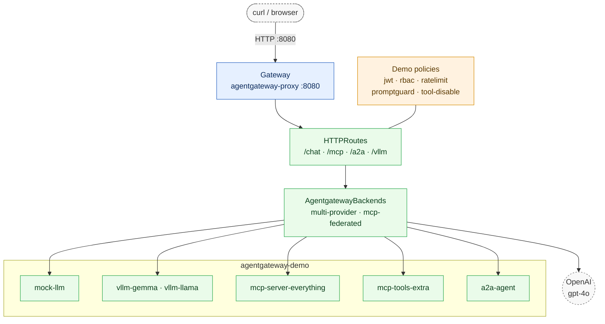
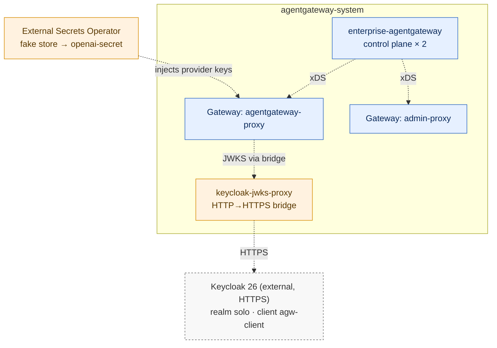
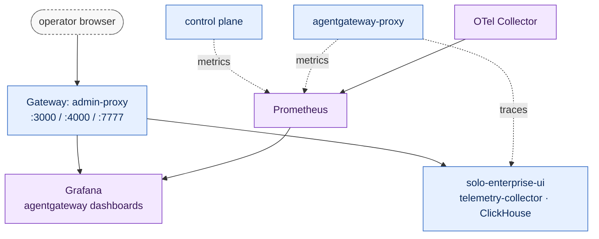

# Architecture — Solo Enterprise for Agentgateway demo

## Request path

How a call reaches a model, an MCP server or an agent. Component detail is in [Component inventory](#component-inventory).

## Control plane and identity

xDS to both data planes, and how JWTs are validated against the external Keycloak.

## Observability

Where metrics and traces go, and what the operator opens.

## Component inventory

| Namespace | Component | Chart / image | Purpose |
|---|---|---|---|
| `agentgateway-system` | `enterprise-agentgateway-crds` + `enterprise-agentgateway` | `oci://us-docker.pkg.dev/solo-public/enterprise-agentgateway/charts/...` | Control plane (2 replicas); translates Gateway API + `AgentgatewayBackend` + `EnterpriseAgentgatewayPolicy` into proxy xDS |
| `agentgateway-system` | `Gateway/agentgateway-proxy` | `GatewayClass: enterprise-agentgateway` | Data-plane proxy on LB :8080 — carries all demo traffic (`/chat`, `/mcp`, `/a2a`) |
| `agentgateway-system` | `Gateway/admin-proxy` | same `GatewayClass` | Separate Gateway for admin UIs — one LB with listeners 3000 (Grafana) · 4000 (Solo UI) · 7777 (STS / OBO). Keycloak is external, not fronted here |
| `agentgateway-system` | `solo-enterprise-ui` + telemetry collector + ClickHouse | `oci://us-docker.pkg.dev/solo-public/solo-enterprise-helm/charts/management` | Solo UI, OTel trace ingest, trace store. Installed by step 02 which also applies the baseline `tracing` policy. |
| *(outside the cluster)* | Keycloak 26 | Your own Keycloak (realm in `../keycloak/`), behind a public HTTPS hostname | OIDC provider (realm `solo`, users `alice`, `bob`, client `agw-client`). Public HTTPS so one issuer serves both the browser and in-cluster pods. Reached for JWKS through the in-cluster `keycloak-jwks-proxy`, since the controller fetches JWKS over plain HTTP via a `backendRef` |
| `external-secrets` | External Secrets Operator | `external-secrets/external-secrets` | Syncs `openai-secret` from the fake `ClusterSecretStore` (swap for Vault in real envs) |
| `agentgateway-demo` | mock-llm | Python HTTP server | OpenAI-shape mock; healthy failover target (group 1) for the failover demo |
| `agentgateway-demo` | mock-llm-broken | same image + ConfigMap, `FAIL_ALL=1` | Unhealthy provider: HTTP 500 on the normal `/v1/chat/completions` path, so the failover demo's primary (group 0) fails the way a real provider does |
| `agentgateway-demo` | vllm-gemma | `python:3.12-slim` + `vllm-mock-app` ConfigMap, `SERVED_MODEL=gemma-4` | OpenAI-compatible stand-in for a self-hosted vLLM server. Implements `/health`, `/v1/models` and `/v1/chat/completions`, and echoes any injected system prompt so per-backend policy is visible in the response. Not real vLLM — no GPU on these nodes, no published vLLM CPU image, and AMD Rome lacks AVX512 |
| `agentgateway-demo` | vllm-llama | same image + ConfigMap, `SERVED_MODEL=llama-30` | The second fleet, so routing and per-backend policy have somewhere to route |
| `agentgateway-demo` | mcp-server-everything + mcp-tools-extra | `node:20-alpine` running `@modelcontextprotocol/server-everything streamableHttp` | Two MCP upstreams multiplexed by the `mcp-federated` backend |
| `agentgateway-demo` | a2a-agent | Solo sample echo agent | Target for `/a2a` demo |
| `agentgateway-demo` | `agent-sa` ServiceAccount | K8s | Actor identity for the RFC 8693 OBO demo (installed by step 09) |
| `monitoring` | OTel Collector + Prometheus + Grafana | standard charts | Metrics + dashboards (token counts, latency, cost) |

## Request paths exercised in demo scripts

| Path prefix | HTTPRoute | Upstream | Demo case |
|---|---|---|---|
| `/chat/*` | `chat` | `multi-provider` AgentgatewayBackend → OpenAI (primary) + mock-llm (failover) | `p02-routing-01` · `p02-routing-02` · `p02-routing-03` · `p02-routing-07` · `p02-routing-09` · `p05-security-01` · `p05-security-02` · `p05-security-04` · `p08-modelcontrols-01` |
| `/chat-split/*` | `chat-split` (demo-only) | 80 OpenAI / 20 mock-llm-1 weighted `backendRefs` | `p02-routing-05` |
| `/chat-content/*` | `chat-content` (demo-only) | `x-model: mock` → mock-llm-1; otherwise → OpenAI | `p02-routing-06` |
| `/token-rate` | ephemeral (created + torn down by the demo) | `openai-primary` AgentgatewayBackend; carries a `RateLimitConfig` with `limitType: TOKEN` (300 tokens/min per `x-user-id`). Owns its own route so it can't collide with `p02-routing-03`'s `entRateLimit` policy on `/chat` | `p02-routing-08` |
| `/vllm/*` | `vllm` | `x-model: llama-30` → `vllm-llama-30` AgentgatewayBackend; otherwise → `vllm-gemma-4`. Installed by `06-install-llm-backends.sh`; the p09 demos apply only policy on top | `p09-selfhosted-01` · `p09-selfhosted-02` · `p09-selfhosted-03` |
| `/budget-demo`, `/budget-control` | ephemeral (created + torn down by the demo) | `openai-primary` AgentgatewayBackend; `/budget-demo` gets an `EnterpriseAgentgatewayBudget` + `entBudgetEnforcement` policy, `/budget-control` does not | `p02-routing-10` |
| `/mcp` | `mcp` | `mcp-federated` AgentgatewayBackend → `mcp-server-everything` + `mcp-tools-extra` | `p03-agents-01` · `p03-agents-02` · `p03-agents-04` |
| `/mcp/search`, `/mcp/code`, `/mcp/composable` | ephemeral (created + torn down by the demo) | `EnterpriseAgentgatewayBackend` with `entMcp.toolMode: Search` / `Code` / composable `steps` | `p03-agents-05` · `p03-agents-06` · `p03-agents-07` |
| `/a2a` | `a2a` (URLRewrite strips prefix) | `a2a-agent` Service | `p03-agents-03` |
| `/oauth2/token` (admin :7777) | STS HTTPRoute | `enterprise-agentgateway` control plane :7777 | `p05-security-03` (OBO) |
| `:3000`, `:4000` (admin) | admin-route-grafana / ui | Grafana / Solo UI Services | operator browser access |

## Control vs data plane

The Solo Enterprise Agentgateway control plane runs as a 2-replica
Deployment in `agentgateway-system`. It watches Gateway API resources
cluster-wide and produces Envoy-xDS config. The **data plane** is a
separate Deployment auto-provisioned by the control plane for each
`Gateway` object (one proxy pod set per Gateway by default — in this
demo that's `agentgateway-proxy` and `admin-proxy`). Traffic policies,
auth extensions, failover rules, etc. are applied via
`EnterpriseAgentgatewayPolicy` CRs attached to `Gateway` /
`HTTPRoute` / `AgentgatewayBackend` through `targetRefs`.

Scale control and data planes independently. `AGENTGATEWAY_CONTROLLER_REPLICAS`
in `.envrc.sample` sets control-plane HA; the data-plane proxy scales via
the Gateway's `spec.infrastructure` (or the chart's default replica count).

## Policy ownership

| Policy / HTTPRoute | Applied by |
|---|---|
| `policy-tracing.yaml` | **baseline** — `02-install-ui.sh` (UI requires it) |
| `policy-jwt.yaml` | `demo/p05-security-01-jwt.sh`, `p05-security-02-promptguard.sh`, `p05-security-03-obo.sh`, `p05-security-04-chat-rbac.sh`, `p02-routing-02-failover.sh`, `p02-routing-03-ratelimit.sh`, `p03-agents-02-mcp-rbac.sh`, `p03-agents-04-mcp-ratelimit.sh` |
| `rbac-virtual-keys-admins.yaml` | **baseline** — `02-install-ui.sh` (admin grant for fine-grained management RBAC) |
| `rbac-httproutes-viewers.yaml` | **baseline** — `02-install-ui.sh` (route-view grant; without it the Routes page is empty) |
| `rbac-budgets-admins.yaml` | **baseline** — `02-install-ui.sh` (admin budget grant; without it Create Budget is disabled) |
| `virtual-keys-rbac-demo.yaml` | `demo/p05-security-07-virtual-key-rbac.sh` |
| `policy-rbac-mcp.yaml` | `demo/p03-agents-02-mcp-rbac.sh` |
| `policy-rbac-chat.yaml` | `demo/p05-security-04-chat-rbac.sh` |
| `policy-ratelimit.yaml` + `ratelimitconfig.yaml` | `demo/p02-routing-03-ratelimit.sh` |
| `policy-ratelimit-mcp.yaml` (reuses `ratelimitconfig.yaml`) | `demo/p03-agents-04-mcp-ratelimit.sh` |
| `policy-token-rate.yaml` + `ratelimitconfig-token-rate.yaml` + `httproute-token-rate.yaml` | `demo/p02-routing-08-token-rate-limit.sh` |
| `policy-promptguard.yaml` | `demo/p05-security-02-promptguard.sh` |
| `policy-health-retry.yaml` | `demo/p02-routing-02-failover.sh` |
| `policy-promptcache.yaml` | `demo/deprecated/prompt-caching.sh` — **deprecated**, not in the demo set |
| `policy-promptenrichment.yaml` | `demo/p02-routing-07-prompt-enrichment.sh` |
| `policy-transformation.yaml` | `demo/p02-routing-09-transformations.sh` |
| `budget-crd.yaml` + `policy-budget-enforcement.yaml` + `httproute-budget-demo.yaml` | `demo/p02-routing-10-spend-budget.sh` |
| `policy-tool-disable.yaml` | `demo/p08-modelcontrols-01-tool-disable.sh` |
| `httproute-chat-weighted.yaml` | `demo/p02-routing-05-weighted-split.sh` |
| `httproute-chat-content-based.yaml` | `demo/p02-routing-06-content-based-routing.sh` |
| `policy-vllm-per-backend.yaml` | `demo/p09-selfhosted-01-vllm-routing.sh` (targets `AgentgatewayBackend`, not a route) |
| `policy-vllm-guardrails.yaml` | `demo/p09-selfhosted-02-vllm-guardrails.sh`, `p09-selfhosted-03-vllm-identity-audit.sh` |
| `policy-vllm-apikey.yaml` + `apikeys-vllm.yaml` | `demo/p09-selfhosted-03-vllm-identity-audit.sh` |
| `policy-vllm-audit.yaml` | `demo/p09-selfhosted-03-vllm-identity-audit.sh` (targets the `Gateway` — `frontend.*` cannot target a route) |

Every non-baseline policy is applied + reverted by its owning demo
script's `trap EXIT`, so running any demo leaves the cluster state
exactly as it was before.

## What is intentionally not here

- **No external rate-limit service.** The rate-limit demo uses the
  inline `RateLimitConfig` + `EnterpriseAgentgatewayPolicy.traffic.entRateLimit`.
  For global enforcement across multiple proxy pods, point
  `entRateLimit.global.rateLimitConfigRefs` at an external rate-limit
  service.
- **Single-cluster only.** "Scalable, Multi-Cloud Deployment" is told
  narratively. Swap `CLUSTER_CONTEXT` in `.envrc` and re-run to demo a
  second cloud; no cross-cluster plumbing is installed.
- **OAuth / OIDC redirect-based login** is not wired for human users of
  `/chat`, `/mcp`, `/a2a`. The demo scripts use Keycloak's password
  grant to fetch tokens non-interactively. For a full browser flow, swap
  to the OAuth2 GatewayExtension path (see the Solo docs).
