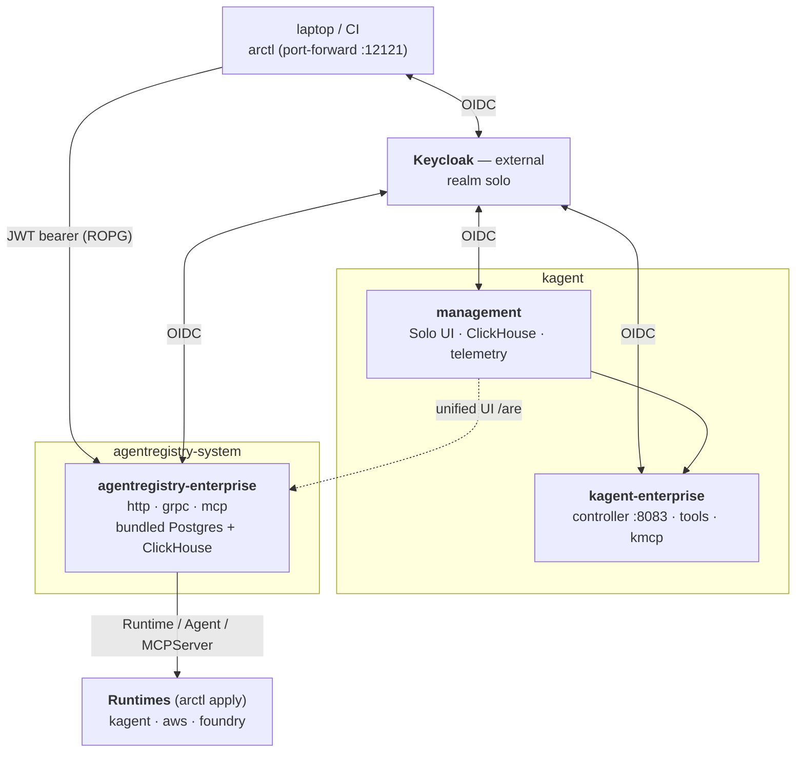

# Architecture

## Components

The install is a **four-chart** deployment, all pulled from the
public `oci://us-docker.pkg.dev/solo-public/...` registries. Unlike the old
v0.0.x line, the `agentregistry-enterprise` chart is **self-contained**: it
bundles its own Postgres, ClickHouse, and an OTel telemetry collector, and
exposes OIDC + RBAC as first-class chart values. The Solo Enterprise UI and
the kagent runtime come from the sibling `management` + `kagent-enterprise`
charts, pinned together by `KAGENT_ENT_VERSION`.

## Prerequisite: an external Keycloak

This demo has **no in-cluster Keycloak**. It points at an external Keycloak you
run, into which you import the realm in [`../keycloak/`](../keycloak/realm-demo.json)
(realm **`solo`**, shared with the `enterprise-agentgateway` demo). The
realm defines the registry clients (`ar-backend` confidential, `ar-cli-interactive`
device, `ar-cli-password` ROPG), the kagent controller client (`kagent-backend`),
and the browser-UI clients (`solo-ui-frontend` public PKCE / `solo-ui-backend`
confidential). The group-membership mapper emits the **`Groups`** claim. All
backend client secrets are `${VAR}` placeholders in the realm file, filled from
Keycloak's environment at import time with the same values as your `.envrc`. The issuer + JWKS
are public HTTPS, reached directly by the browser, the registry/kagent/UI
backends, and the demo scripts. Set `KEYCLOAK_EXTERNAL_URL` in `.envrc`.

## Install order

1. **kagent + management (`KAGENT_ENT_VERSION`)** — `02-install-kagent.sh` installs three
   charts into the kagent namespace:
   - `management` — UI + ClickHouse + telemetry + OIDC, gated behind
     `products.{kagent,agentregistry}.enabled`. OIDC points at the external
     `solo` realm: `oidc.issuer`, `ui.frontend.oidc.clientId=solo-ui-frontend`,
     `ui.frontend.uiBackendHost` (browser-facing UI URL — empty means the SPA
     never starts the login flow), and `ui.backend.oidc` via a k8s `secretRef`
     (the `solo-ui-backend` secret never lands in Helm values). A tolerant
     roleMapper (passed via `-f`) defaults authenticated users with no `Groups`
     claim to Admin.
   - `kagent-enterprise-crds` — CRDs only.
   - `kagent-enterprise` — the agent runtime controller (+ kagent-tools, kmcp);
     OIDC `clientId=kagent-backend` with the client secret from `.envrc`.
   Plus a generated RSA OBO JWT key (`secret/jwt`) and the Role + RoleBinding
   that lets the registry server SA (`agentregistry-enterprise`) manage
   `Agent` CRs in the kagent namespace.
2. **Enterprise Agentregistry** — `helm upgrade` with native
   `oidc.*` values. No image-pull secret (public image) and **no** post-
   install ConfigMap/Secret patching. `CLUSTER_TYPE` selects LoadBalancer
   (gke) vs ClusterIP + port-forward (kind).
3. **arctl CLI** — installed by the official `install.sh` (pinned to
   `$ARCTL_VERSION`), then a port-forward of the registry server (:12121) and
   a headless `arctl user login --oidc-flow=password-credentials` as the
   admin user so every subsequent script has a valid session.
4. **Register runtimes** — `arctl apply -f` a `Runtime` (`type: Kagent`)
   always; AWS Bedrock (deploy) and Microsoft Foundry
   (`type: MicrosoftFoundry`, discovery-only) Runtimes only if their env vars
   are set.

### Version pinning notes

- `AGENTREGISTRY_VERSION` — chart + server image, public at
  `solo-public/agentregistry-enterprise`.
- `KAGENT_ENT_VERSION` — the management, kagent-enterprise, and
  kagent-enterprise-crds charts share this version.
- `ARCTL_VERSION` — the CLI is installed via the official installer,
  pinned to match the registry line. arctl tracks the agentregistry release
  train, not the agentgateway one, so the two can sit on different versions.
  The retired v0.0.x CLI (`arctl mcp/agent/
  provider/role`) is **incompatible** with this server; `04` guards against it.

## Request paths exercised by the demos

| Path | Used by |
|---|---|
| `${KEYCLOAK_EXTERNAL_URL}/realms/solo/protocol/openid-connect/token` | `arctl user login` + `get_jwt` helper (ROPG via `ar-cli-password`); mints a token with the `Groups` claim. |
| `http://localhost:12121/v0/*` | REST surface arctl talks to (`get`, `apply`, `delete`, `user whoami`). |
| `svc/solo-enterprise-ui:80` (kagent ns) | Solo Enterprise management UI; reached via `ui-login.sh` (port-forward `4000:80` → `http://localhost:4000`, registry views at `/are`). |
| `svc/agentregistry-enterprise-server:21212` | gRPC push agentgateway consumes (`p04-integration-01`). |
| `svc/agentregistry-enterprise-server:31313` | MCP HTTP endpoint (aggregated tool surface). |
| `svc/agentregistry-clickhouse:8123` | ClickHouse HTTP for telemetry/insights queries (`p05-obs-01`). |

## Policy ownership

| Manifest | Installed by | Owned by |
|---|---|---|
| (realm config) | external Keycloak — see [`../keycloak/`](../keycloak/realm-demo.json) | The `solo` realm lives outside this demo. Demos read users/passwords from `.envrc` but don't mutate the realm. |
| `manifests/kagent/rolebinding-agentregistry-writer.yaml` | `02-install-kagent.sh` | Install-time. Deleted by `02 --cleanup`. |
| `manifests/agentregistry/values.yaml` | `03-install-agentregistry.sh` | Stable, non-secret overrides; OIDC + service type via `--set`. |
| (no manifest) — catalog/deploy demos use `arctl init` to scaffold a project in a tempdir, then `arctl apply -f` | `demo/catalog-*`, `demo/deploy-*` | Per-demo; tempdir cleaned up in the trap. |

## Cross-product boundary

`p04-integration-01-agentgateway-pull.sh` explicitly does NOT install
agentgateway. The cross-product demo (agentregistry's gRPC push feeding
agentgateway's tool table) belongs in [`../enterprise-agentgateway/`](../enterprise-agentgateway/).
